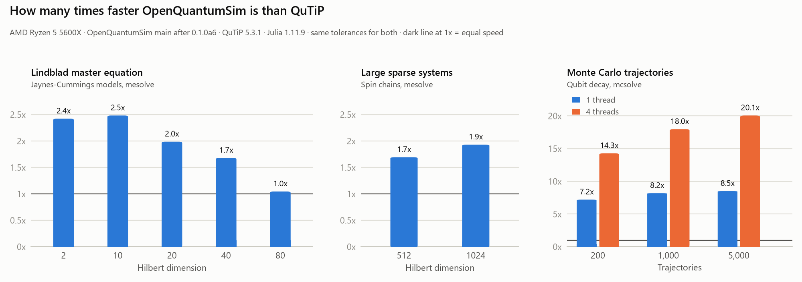

Performance Benchmarks
======================

This page records a reproducible OpenQuantumSim performance baseline. The
numbers below are not a universal leaderboard; they document one hardware and
software configuration so future benchmark results can be compared against the
same reference point.

Current Snapshot
----------------

Measured on 2026-11-16 on the ``main`` line after ``0.1.0a6``: with the solver
health checks, the waiting-time Monte Carlo stepper, and the performance work
described under *What Changed* below.

.. list-table::
   :header-rows: 1

   * - Item
     - Value
   * - CPU
     - AMD Ryzen 5 5600X (6 cores, 12 logical CPUs)
   * - Platform
     - Windows 11, x86-64
   * - Python
     - 3.13.14
   * - Julia backend runtime
     - 1.11.9 through JuliaCall 0.9.37
   * - QuTiP
     - 5.3.1
   * - NumPy / SciPy / h5py
     - 2.5.4 / 1.18.1 / 3.16.0

Every number in this section comes from one command, which writes JSON
reports to ``runs/benchmarks/<date>/`` and redraws the figure above:

.. code-block:: bash

   bash scripts/run_benchmarks.sh

The individual commands are listed in that script and below. Timings are
wall-clock medians; medians moved by up to about 20% between runs at the
larger sizes.

Lindblad Master Equation vs QuTiP
~~~~~~~~~~~~~~~~~~~~~~~~~~~~~~~~~

.. code-block:: bash

   python benchmarks/bench_vs_qutip.py --repeats 9 --time-points 81 --t-final 6.0 \
       --cases qubit jc5 jc10 jc20 jc40 --oqs-methods auto krylov ode

``rtol=1e-8``, ``atol=1e-10`` for both libraries, median of nine runs,
OpenQuantumSim with its default ``method="auto"``.

.. list-table::
   :header-rows: 1

   * - Case
     - Dimension
     - QuTiP
     - OpenQuantumSim
     - Speed vs QuTiP
     - Max expectation delta
   * - Qubit decay
     - 2
     - 2.05 ms
     - 0.85 ms
     - 2.42x
     - 7.49e-09
   * - Jaynes-Cummings 5
     - 10
     - 2.72 ms
     - 1.10 ms
     - 2.48x
     - 1.21e-09
   * - Jaynes-Cummings 10
     - 20
     - 3.37 ms
     - 1.70 ms
     - 1.99x
     - 7.23e-09
   * - Jaynes-Cummings 20
     - 40
     - 5.27 ms
     - 3.14 ms
     - 1.68x
     - 1.96e-08
   * - Jaynes-Cummings 40
     - 80
     - 13.30 ms
     - 12.74 ms
     - 1.04x
     - 4.71e-08

``method="krylov"`` was slower than the default at every size (0.18x-1.6x of
QuTiP's speed) and is only worth trying for long time steps.

Large Sparse Systems vs QuTiP
~~~~~~~~~~~~~~~~~~~~~~~~~~~~~

.. code-block:: bash

   python benchmarks/bench_sparse_scaling.py --cases spin9 spin10 \
       --time-points 21 --t-final 5 --repeats 3

Nearest-neighbour Heisenberg spin chains with a transverse field and local
amplitude damping; ``rtol=1e-6``, ``atol=1e-8`` for both libraries, one Julia
thread.

.. list-table::
   :header-rows: 1

   * - Case
     - Dimension
     - QuTiP
     - OpenQuantumSim
     - Speed vs QuTiP
     - ``0.1.0a6``, same machine
     - Max expectation delta
   * - 9 spins
     - 512
     - 6.98 s
     - 4.12 s
     - 1.69x
     - 9.19 s (0.73x)
     - 1.2e-08
   * - 10 spins
     - 1024
     - 37.2 s
     - 19.3 s
     - 1.93x
     - 75.9 s (0.68x)
     - 1.7e-08

QuTiP used to be faster on these cases. With several Julia threads
(``JULIA_NUM_THREADS=4``) the large sparse products are split across threads;
the dimension-512 solve then took 2.6 s in the backend instead of 3.7 s.
Dimension 2048 (11 spins) needs several GB of RAM for the stored states.

Integrator Choices
~~~~~~~~~~~~~~~~~~

.. code-block:: bash

   python benchmarks/bench_mesolve.py --cases jc5 jc10 jc20

The same Jaynes-Cummings models at ``rtol=1e-8``, ``atol=1e-10``, compared
with a reference solve by Vern9 at ``rtol=1e-12``.

.. list-table::
   :header-rows: 1

   * - Dimension
     - Tsit5 (default)
     - Vern7
     - Vern9
     - Krylov
     - Tsit5 max error
   * - 10
     - 0.78 ms
     - 1.33 ms
     - 1.39 ms
     - 1.50 ms
     - 4.7e-10
   * - 20
     - 1.39 ms
     - 1.71 ms
     - 1.75 ms
     - 5.75 ms
     - 7.5e-10
   * - 40
     - 4.08 ms
     - 4.96 ms
     - 7.58 ms
     - 12.34 ms
     - 1.4e-09

Tsit5 is the fastest at these sizes and stays well inside the requested
tolerance. Vern7 and Vern9 reach errors near ``1e-13`` for about 20-85% more
time, which is worth it only when that accuracy is needed.

Monte Carlo Trajectories vs QuTiP
~~~~~~~~~~~~~~~~~~~~~~~~~~~~~~~~~

.. code-block:: bash

   JULIA_NUM_THREADS=4 python benchmarks/bench_mcsolve_vs_qutip.py \
       --n-traj 200 1000 5000 --repeats 5

Spontaneous-emission qubit, ``gamma=0.35``, 31 output times up to ``t=2``,
QuTiP's default tolerances (``rtol=1e-6``, ``atol=1e-8``) for both. QuTiP runs
serially, its default. The script checks both results against the exact
``exp(-gamma t)``, and checks that the one-thread and four-thread results are
identical.

.. list-table::
   :header-rows: 1

   * - Trajectories
     - QuTiP
     - OQS, 1 thread
     - OQS, 4 threads
     - 1 thread vs QuTiP
     - 4 threads vs QuTiP
     - Max error QuTiP / OQS
   * - 200
     - 74.1 ms
     - 10.3 ms
     - 5.2 ms
     - 7.2x
     - 14.3x
     - 0.070 / 0.070
   * - 1000
     - 371.0 ms
     - 45.3 ms
     - 20.6 ms
     - 8.2x
     - 18.0x
     - 0.033 / 0.022
   * - 5000
     - 1852 ms
     - 217.6 ms
     - 92.3 ms
     - 8.5x
     - 20.1x
     - 0.016 / 0.010

The errors are statistical: about twice the largest possible standard error
of a mean of that many trajectories, taken as the worst of 31 times and five
runs. Both libraries are equally accurate.

Monte Carlo Thread Scaling
~~~~~~~~~~~~~~~~~~~~~~~~~~

.. code-block:: bash

   JULIA_NUM_THREADS=4 python benchmarks/bench_mcsolve.py \
       --n-traj 5000 --time-points 41 --t-final 4.0 --repeats 5 --n-jobs 1 2 4

.. list-table::
   :header-rows: 1

   * - ``n_jobs``
     - Median
     - Speed-up
     - Max difference from 1 thread
   * - 1
     - 277 ms
     - 1.00x
     - 0
   * - 2
     - 222 ms
     - 1.25x
     - 0
   * - 4
     - 119 ms
     - 2.33x
     - 0

A qubit trajectory is so cheap that per-trajectory overhead limits the
scaling; larger systems scale better. The results are bit-for-bit identical
for every thread count.

Dicke Mutual-Information Batches
~~~~~~~~~~~~~~~~~~~~~~~~~~~~~~~~

.. code-block:: bash

   JULIA_NUM_THREADS=1 python examples/dicke/bench_mi.py --N 4 --kappa 0.1 \
       --n-traj 40 --time-points 21 --t-final 0.2 --batch-size 10 --repeats 3 \
       --n-jobs 1 2 --target-n-traj 1000

.. list-table::
   :header-rows: 1

   * - ``n_jobs``
     - Median
     - Trajectories / s
     - Difference from serial
   * - 1
     - 0.42 s
     - 95.8
     - 0
   * - 2 (processes)
     - 29.0 s
     - 1.4
     - 0

Each worker process starts its own Julia runtime, which costs far more than
these short batches. Use one process, with Julia threads for parallelism,
unless batches run for minutes.

What Changed
~~~~~~~~~~~~

Backend timings for the same problems before and after the performance work,
measured directly in Julia on the same machine with one thread.

.. list-table::
   :header-rows: 1

   * - Solver and problem
     - Before
     - After
     - Change
   * - ``mesolve``, spin chain, dimension 512
     - about 10.7 s
     - 3.7 s
     - Generator built from triplets (2.2 s to 0.4 s) and applied row by row
   * - ``mcsolve``, 40 trajectories, spin chain, dimension 256 / 512
     - 2.45 s / 6.24 s
     - 0.40 s / 0.88 s
     - Sparse operators in trajectories
   * - Time-dependent ``mesolve``, driven Jaynes-Cummings, dimension 40 / 80
     - 84 ms / 535 ms
     - 13 ms / 53 ms
     - Sparse superoperator sum instead of dense products
   * - ``brmesolve``, Jaynes-Cummings, dimension 20 / 40
     - 1.8 s / 54 s
     - 2.8 ms / 12 ms
     - Sorted frequency grouping; sparse generator in the eigenbasis
   * - ``correlation_2op_1t``, Jaynes-Cummings, dimension 20 / 40
     - 20 ms / 88 ms
     - 8 ms / 31 ms
     - ODE propagation for ``method="auto"``
   * - Health checks inside ``mesolve``, dimension 40
     - 6.2 ms
     - 0.3 ms
     - Positivity spot-checked with a Cholesky test

All of these give the same results as before to within the requested
tolerance; the test suite compares each new path with the old formula or an
independent solve.

Historical Snapshots
--------------------

The sections below were measured with ``0.1.0a2`` to ``0.1.0a6``, mostly on
an Apple M1, before the solver health checks, the waiting-time Monte Carlo
stepper and the performance work above. They are kept for comparison and
should not be quoted for the current code. The startup and sysimage numbers
have not been re-measured since ``0.1.0a5``.

Benchmark Environment
~~~~~~~~~~~~~~~~~~~~~

.. list-table::
   :header-rows: 1

   * - Item
     - Value
   * - Date
     - 2026-05-22
   * - OpenQuantumSim commit
     - startup optimization snapshot
   * - CPU
     - Apple M1
   * - Logical CPU count
     - 8
   * - Platform
     - macOS 26.4.1 arm64
   * - Python
     - 3.14.3
   * - Julia backend runtime
     - 1.11.9 through JuliaCall
   * - ``julia --version``
     - 1.12.5
   * - OpenQuantumSim
     - 0.1.0a2
   * - QuTiP
     - 5.2.3
   * - NumPy / SciPy / h5py
     - 2.4.4 / 1.17.1 / 3.16.0

Deterministic Solver: OpenQuantumSim vs QuTiP
~~~~~~~~~~~~~~~~~~~~~~~~~~~~~~~~~~~~~~~~~~~~~

Command:

.. code-block:: bash

   MPLCONFIGDIR=/private/tmp/oqs-mpl \
   python benchmarks/bench_vs_qutip.py \
       --repeats 5 \
       --time-points 81 \
       --t-final 6.0 \
       --cases qubit jc5 jc10 \
       --oqs-methods auto krylov ode \
       --json runs/benchmarks/bench_vs_qutip_after_stats.json

Settings: ``rtol=1e-8``, ``atol=1e-10``. OpenQuantumSim used the default
single-threaded backend process for this deterministic benchmark.

.. list-table::
   :header-rows: 1

   * - Case
     - Dimension
     - QuTiP median
     - OQS auto median
     - Best OQS median
     - OQS auto vs QuTiP
     - Max expectation delta
   * - Qubit decay
     - 2
     - 1.43 ms
     - 1.00 ms
     - 0.77 ms (``ode``)
     - 1.42x
     - 7.49e-09
   * - Jaynes-Cummings 5
     - 10
     - 2.18 ms
     - 1.14 ms
     - 1.14 ms (``auto``)
     - 1.90x
     - 1.21e-09
   * - Jaynes-Cummings 10
     - 20
     - 6.71 ms
     - 2.60 ms
     - 2.08 ms (``ode``)
     - 2.58x
     - 7.23e-09

Interpretation: after reducing solver-stat conversion overhead at the
Python-Julia boundary, OpenQuantumSim is faster than QuTiP for these small
deterministic benchmark cases on this machine. Expectation values agree with
QuTiP at about ``1e-9`` to ``1e-8``.

Python Wrapper Profile
~~~~~~~~~~~~~~~~~~~~~~

The main small-system bottleneck was not the Julia integrator. It was repeated
Python-side probing of optional fields in the Julia ``NamedTuple`` used for
``Result.solver_stats``. The conversion now uses the fields reported by
``dir(...)`` and avoids exception-heavy lookups for fields that are not present.

.. list-table::
   :header-rows: 1

   * - Profile
     - Workload
     - Python-visible cumulative time
     - Solver-stat conversion time
   * - Before
     - 100 warm qubit-decay ``mesolve`` calls
     - 0.671 s
     - 0.601 s
   * - After
     - 100 warm qubit-decay ``mesolve`` calls
     - 0.050 s
     - 0.007 s

Backend Startup Profile
~~~~~~~~~~~~~~~~~~~~~~~

Command:

.. code-block:: bash

   PYTHON_JULIACALL_HANDLE_SIGNALS=yes python - <<'PY'
   import time
   import numpy as np
   import openquantumsim as oqs
   from openquantumsim._julia_bridge import get_julia, load_backend

   started = time.perf_counter(); get_julia()
   print("get_julia", time.perf_counter() - started)
   started = time.perf_counter(); load_backend()
   print("load_backend", time.perf_counter() - started)

   space = oqs.SpinSpace(0.5, label="atom")
   psi = oqs.basis(space, "up")
   H = 0.0 * oqs.sigmaz(space)
   c = np.sqrt(0.35) * oqs.sigmam(space)
   e = oqs.Operator(oqs.ket2dm(psi), space, "P_excited")
   t = np.linspace(0.0, 1.0, 11)

   started = time.perf_counter()
   oqs.mesolve(H, oqs.ket2dm(psi), t, c_ops=[c], e_ops=[e])
   print("first_mesolve", time.perf_counter() - started)
   PY

The profile below measures a fresh Python process after the Julia backend has
already been set up once. Normal runtime loads now skip ``Pkg.instantiate()``
unless loading the backend fails; ``oqs setup-julia`` still forces
instantiation for installation validation.

.. list-table::
   :header-rows: 1

   * - Profile
     - ``import openquantumsim``
     - ``get_julia()``
     - ``load_backend()``
     - First ``mesolve``
     - Total
   * - Before
     - 0.786 s
     - 2.602 s
     - 11.337 s
     - 7.775 s
     - 22.500 s
   * - After
     - 0.334 s
     - 3.005 s
     - 6.139 s
     - 7.816 s
     - 17.294 s

The same change also suppresses routine Julia package-manager output during
normal solver calls.

Local Sysimage Startup
~~~~~~~~~~~~~~~~~~~~~~

For repeated solver sessions, ``oqs build-sysimage`` compiles the packaged Julia
backend into a local sysimage and validates it with a fresh JuliaCall process
before it is registered for automatic reuse.

Command:

.. code-block:: bash

   python benchmarks/bench_startup_sysimage.py \
       --install-local . \
       --repeats 1 \
       --json runs/benchmarks/bench_startup_sysimage_0.1.0a5_m1_2026-05-27.json

Apple M1, Python 3.14.3, Julia 1.11.9, single Julia thread:

.. list-table::
   :header-rows: 1

   * - Profile
     - ``get_julia()``
     - ``load_backend()``
     - First ``mesolve``
     - Total
   * - Cold, no setup
     - 17.465 s
     - 20.773 s
     - 20.336 s
     - 72.315 s
   * - Warm, no sysimage
     - 2.301 s
     - 10.407 s
     - 13.711 s
     - 26.940 s
   * - Warm, validated sysimage
     - 4.756 s
     - 3.570 s
     - 3.894 s
     - 12.767 s

The sysimage build took 692.064 s and produced a 543 MB image on this machine.
The warm sysimage profile was 2.1x faster end-to-end than warm startup without
a sysimage, with the first solver call itself 3.5x faster.

Larger Deterministic Spot Checks
~~~~~~~~~~~~~~~~~~~~~~~~~~~~~~~~

Command:

.. code-block:: bash

   MPLBACKEND=Agg PYTHON_JULIACALL_HANDLE_SIGNALS=yes \
   python benchmarks/bench_vs_qutip.py \
       --repeats 3 \
       --time-points 81 \
       --t-final 6.0 \
       --cases jc20 jc40 \
       --oqs-methods auto ode krylov \
       --json runs/benchmarks/bench_vs_qutip_larger_startup_patch.json

.. list-table::
   :header-rows: 1

   * - Case
     - Dimension
     - QuTiP median
     - OQS auto median
     - Best OQS median
     - OQS auto vs QuTiP
     - Max expectation delta
   * - Jaynes-Cummings 20
     - 40
     - 3.91 ms
     - 2.95 ms
     - 2.95 ms (``auto``)
     - 1.32x
     - 1.96e-08
   * - Jaynes-Cummings 40
     - 80
     - 13.93 ms
     - 10.38 ms
     - 8.52 ms (``ode``)
     - 1.34x
     - 4.71e-08

Monte Carlo Wave Functions: OpenQuantumSim vs QuTiP
~~~~~~~~~~~~~~~~~~~~~~~~~~~~~~~~~~~~~~~~~~~~~~~~~~~

.. note::

   The numbers in this section were measured with the fixed-step trajectory
   stepper used up to ``0.1.0a6``, with OpenQuantumSim on four threads
   against serial QuTiP at different tolerances. See the Current Snapshot
   above for the waiting-time stepper with matched tolerances.

Command:

.. code-block:: bash

   PYTHON_JULIACALL_HANDLE_SIGNALS=yes JULIA_NUM_THREADS=4 \
   python benchmarks/bench_mcsolve_vs_qutip.py \
       --n-traj 50 200 1000 \
       --time-points 31 \
       --t-final 2.0 \
       --max-step 0.02 \
       --repeats 3 \
       --json runs/benchmarks/bench_mcsolve_vs_qutip_m1_2026-05-22.json

Settings: spontaneous-emission qubit, ``gamma=0.35``, one excited-state
projector, QuTiP ``mcsolve`` with progress disabled, OpenQuantumSim ``mcsolve``
with ``n_jobs=-1`` and four Julia threads.

.. list-table::
   :header-rows: 1

   * - Trajectories
     - QuTiP median
     - OQS median
     - OQS backend wall time
     - Workers
     - OQS vs QuTiP
     - OQS backend vs QuTiP
   * - 50
     - 8.85 ms
     - 1.79 ms
     - 0.46 ms
     - 4
     - 4.96x
     - 19.06x
   * - 200
     - 33.58 ms
     - 3.22 ms
     - 1.71 ms
     - 4
     - 10.44x
     - 19.67x
   * - 1000
     - 168.01 ms
     - 18.60 ms
     - 17.25 ms
     - 4
     - 9.03x
     - 9.74x

Interpretation: for this MCWF smoke benchmark, threaded backend-side
aggregation gives OpenQuantumSim a clear trajectory-throughput advantage over
QuTiP after backend warmup. The exact speedup is workload-specific and should
be re-measured for larger Hilbert spaces and more expensive observables.

Monte Carlo Wave Function Scaling
~~~~~~~~~~~~~~~~~~~~~~~~~~~~~~~~~

Command:

.. code-block:: bash

   JULIA_NUM_THREADS=4 MPLCONFIGDIR=/private/tmp/oqs-mpl \
   python benchmarks/bench_mcsolve.py \
       --n-traj 200 \
       --time-points 31 \
       --t-final 2.0 \
       --max-step 0.02 \
       --repeats 3 \
       --warmup-trajectories 10 \
       --n-jobs 1 -1 \
       --json runs/benchmarks/bench_mcsolve_m1_2026-05-14.json

.. list-table::
   :header-rows: 1

   * - ``n_jobs``
     - Workers
     - Threaded
     - Median elapsed
     - Backend wall time
     - Speedup vs serial
     - Max expectation delta
   * - 1
     - 1
     - False
     - 6.595 ms
     - 3.868 ms
     - 1.00x
     - 1.00e-02
   * - -1
     - 4
     - True
     - 4.092 ms
     - 1.542 ms
     - 1.61x
     - 1.00e-02

Interpretation: backend-side trajectory aggregation and threading work. The
small benchmark shows useful scaling, though the wall time is still heavily
affected by Python-call overhead at this size. Larger trajectory counts should
give a clearer measure of Julia-side scaling.

Dicke Mutual-Information Batch Runner
~~~~~~~~~~~~~~~~~~~~~~~~~~~~~~~~~~~~~

Command:

.. code-block:: bash

   JULIA_NUM_THREADS=1 MPLCONFIGDIR=/private/tmp/oqs-mpl \
   python examples/dicke/bench_mi.py \
       --N 4 \
       --kappa 0.1 \
       --n-traj 12 \
       --time-points 21 \
       --t-final 0.2 \
       --max-step 0.02 \
       --batch-size 2 \
       --repeats 2 \
       --warmup-trajectories 1 \
       --n-jobs 1 2 \
       --target-n-traj 1000 \
       --json runs/benchmarks/bench_dicke_mi_m1_2026-05-14.json

.. list-table::
   :header-rows: 1

   * - ``n_jobs``
     - Workers
     - Median elapsed
     - Trajectories / s
     - Seconds / trajectory
     - Speedup vs serial
   * - 1
     - 1
     - 0.0836 s
     - 143.46
     - 0.0070
     - 1.00x
   * - 2
     - 2
     - 19.7627 s
     - 0.607
     - 1.6469
     - 0.004x

Interpretation: this small Dicke MI benchmark exposes process-startup overhead.
Each short-lived worker initializes its own Julia backend, so process
parallelism is slower for small batches. Larger batches better amortize startup
costs.

Sparse Scaling (Hilbert Dimensions 512-2048)
~~~~~~~~~~~~~~~~~~~~~~~~~~~~~~~~~~~~~~~~~~~~~

``benchmarks/bench_sparse_scaling.py`` measures ``mesolve`` on nearest-neighbour
spin chains with local amplitude damping, where the Hamiltonian and collapse
operators are sparse and the dimension grows as ``2**n_spins``. QuTiP timings
are included when QuTiP is installed.

Warm timings on a Windows 11 desktop (2026-09-30, backend precompiled;
OpenQuantumSim 0.1.0a6 vs QuTiP 5.3.1; 21 time points, ``t_final=5``,
``rtol=1e-6``, ``atol=1e-8``):

.. list-table::
   :header-rows: 1

   * - Case
     - Hilbert dim
     - OpenQuantumSim
     - QuTiP
     - Speedup
     - max abs delta expect
   * - spin9
     - 512
     - 9.19 s
     - 6.70 s
     - 0.73x
     - 1.2e-08
   * - spin10
     - 1024
     - 75.9 s
     - 51.2 s
     - 0.68x
     - 1.7e-08

Both engines agree to about ``1e-8``. Interpretation: the OpenQuantumSim
advantage documented for the dense reference cases (dimension up to 80) does
not carry over to these sparse spin-chain cases at dimension 512-1024, where
QuTiP is currently faster. Run the script yourself to reproduce or challenge
these numbers:

.. code-block:: bash

   python benchmarks/bench_sparse_scaling.py --cases spin9 spin10 --json runs/sparse_scaling.json

.. note::

   Solving at dimension 2048 (``spin11``) needs several GB of free RAM for
   dense state storage; avoid running it alongside other workloads.

Reproducing Results
-------------------

``bash scripts/run_benchmarks.sh`` re-runs every current benchmark and writes
JSON reports to ``runs/benchmarks/<date>/``, which Git ignores; add
``--sysimage`` to also time startup with a freshly built sysimage (about 15
minutes). ``python benchmarks/plot_benchmark_summary.py <report directory>``
redraws the summary figure from those reports. Close other heavy programs
first: every number is a wall-clock time.
